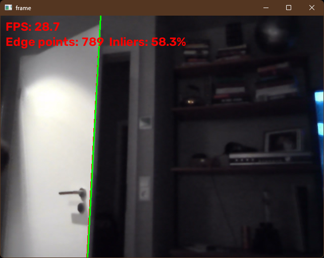
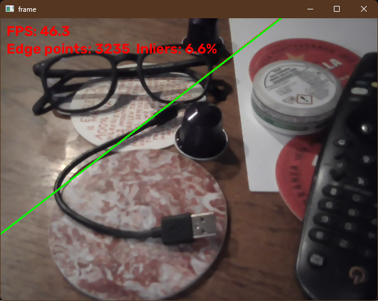

# Assignment 2: Line detection with RANSAC
Github: 

All numbers come from my own runs. Raw logs are the CSV files in `results/`, one per run, with a screenshot of the same name.

**Code**
- `main.py`: the live loop (read frame → Canny → RANSAC → least squares → display). The settings for each run are in the `RUNS` table at the top.
- `helpers/line_detectors.py`: edge points, RANSAC, least-squares fit and the iteration formula.
- `helpers/image_manipulation.py`: colour conversion, resizing and drawing.

## Method (tasks 1–5)

1. Each frame is converted to grayscale and run through `cv2.Canny`.
2. The edge pixels are collected with `np.nonzero`, which returns (row, col) = (y, x). They are swapped once to (x, y).
3. **RANSAC** (own implementation): two random edge points give a line in normal form $ax + by + c = 0$ with $a^2 + b^2 = 1$. Then $|ax + by + c|$ is the distance in pixels, and points closer than $t$ are inliers. The line with the most inliers is kept.
4. **Least squares:** the best line is refined with a total least-squares fit to its inliers (SVD). This minimises the perpendicular distance, so it also works for vertical lines.
5. Both lines are drawn across the frame (red = RANSAC, green = least squares), with the FPS, number of edge points and inlier ratio.

The number of iterations needed is

$$N = \frac{\log(1 - p)}{\log\left(1 - (1 - e)^2\right)}$$

with $p = 0.95$ and $e$ = measured outlier ratio = 1 − inliers / edge points.

## Runs

Two scenes: **simple** (a sheet of paper on a plain table) and **busy** (the same paper with curved objects around it that do not cross the tracked edge).

| Run | Scale | Canny | Iterations | $t$ [px] | Every k-th point |
|---|---|---|---|---|---|
| 01 Baseline | 1.0 | 100/200 | 100 | 2.0 | 1 |
| 02 Half size | 0.5 | 100/200 | 100 | 2.0 | 1 |
| 03 High Canny | 1.0 | 150/300 | 100 | 2.0 | 1 |
| 04 Every 10th | 1.0 | 100/200 | 100 | 2.0 | 10 |
| 05 Tuned 01 | 1.0 | 200/400 | 300 | 1.5 | 5 |
| 05 Tuned 02 | 1.0 | 200/400 | 500 | 1.5 | 5 |
| 06 Tracking 01 | 1.0 | 200/400 | 500 | 1.5 | 5 |
| 06 Tracking 02/03 | 1.0 | 150/300 | 300 | 1.5 | 5 |

## Results table

Mean values per run. Time per frame = 1 / FPS. Line on edge = share of frames where the line was on the paper edge.

| Run | Scene | Time per frame [ms] | Capture [ms] | Canny [ms] | RANSAC [ms] | Edge points | Inlier ratio | N (formula) | Line on edge |
|---|---|---|---|---|---|---|---|---|---|
| 01 Baseline | simple | 33.4 | 25.6 | 1.8 | 2.7 | 633 | 47 % | 13 | 100 % |
| 02 Half size | simple | 34.6 | 18.7 | 0.7 | 3.1 | 500 | 30 % | 34 | 100 % |
| 03 High Canny | simple | 33.4 | 24.4 | 2.0 | 3.2 | 511 | 58 % | 7 | 100 % |
| 04 Every 10th | simple | 33.3 | 24.6 | 2.0 | 2.8 | 654 | 45 % | 13 | 100 % |
| 01 Baseline | busy | 33.6 | 18.3 | 2.8 | 7.8 | 10 213 | 3 % | 3 444 | 3 % |
| 02 Half size | busy | 33.8 | 18.3 | 1.2 | 6.9 | 6 443 | 4 % | 2 162 | 0 % |
| 03 High Canny | busy | 33.5 | 21.3 | 2.5 | 5.5 | 5 213 | 5 % | 1 281 | 25 % |
| 04 Every 10th | busy | 33.4 | 21.9 | 2.8 | 4.2 | 10 988 | 3 % | 4 312 | 2 % |
| 05 Tuned 01 | busy | 34.3 | 14.5 | 2.6 | 12.4 | 3 096 | 9 % | 356 | 79 % |
| 05 Tuned 02 | busy | 38.3 | 9.9 | 2.6 | 20.9 | 2 850 | 10 % | 284 | 93 % |

- **Capture** includes waiting for the camera, so it shrinks when the processing takes longer. The camera delivers 30 fps, so the time per frame stays at ~33 ms until the processing itself takes longer than that (05 Tuned 02).
- **Canny** includes the grayscale conversion and collecting the edge points.

## Iterations: used vs. needed

- **Simple scene:** the inlier ratio is 45–58 %, so the formula asks for 7–34 iterations. The 100 used is more than enough, and the line finds the edge in every frame.
- **Busy scene:** the inlier ratio drops to 3 %, and the formula asks for ~3 400 iterations. With 100, the chance of drawing two points on the edge in a frame is only $1 - (1 - 0.03^2)^{100} \approx 9\,\%$. The line mostly sits on the clutter and only flickers to the edge now and then.

## Speed-ups

| Speed-up | Frame rate | Line quality |
|---|---|---|
| Half size | Canny ~2.5× faster | Worse. The edge shrinks to half as many pixels, but the texture does not, so the inlier ratio drops (47 → 30 % in the simple scene) and the angle error grows (0.27° → 0.40°) |
| Higher Canny thresholds | Fewer points, RANSAC faster in the busy scene (7.8 → 5.5 ms) | Better. Weak texture edges disappear, the strong paper edge stays. Inlier ratio 47 → 58 % (simple), N 13 → 7 |
| Every 10th point | RANSAC faster in the busy scene (7.8 → 4.2 ms), no change in the simple scene | Unchanged. The final inliers are still counted on all points |

None of the speed-ups changes the FPS in runs 01–04, because Canny + RANSAC take less than the 33 ms between camera frames. In the simple scene with ~600 points, the RANSAC time is mostly the Python loop itself, so checking fewer points does not help there.

## RANSAC vs. least squares

The refined line differs from the RANSAC line by **0.1–0.4°** on average. RANSAC finds the right line, and least squares only straightens it slightly, because the two sampled points carry pixel noise while the fit uses all ~300 inliers.

## Tuning (task 6)

To work in the busy scene at video rate:
- **Canny 200/400:** removes most of the texture (10 213 → 3 096 points) and raises the inlier ratio to 9–10 %.
- **$t$ = 1.5 px:** a narrower band, so lines through texture collect fewer points.
- **Every 5th point:** makes each iteration cheaper, which allows more iterations.
- **Iterations:** with 300 (below the formula's N ≈ 356) the line is on the edge in 79 % of frames. With 500 (above N ≈ 284) it is 93 %. The cost is 21 ms of RANSAC, which brings the frame rate down to 26 fps.

## Tracking and other lines

**Tracking 01** (tuned settings, 200/400) was poor. In most frames Canny found **no edge points**. Moving the paper or the camera blurs the edges, and the room is darker and lower in contrast, so the gradients fall below the high threshold.

**Tracking 02** (Canny 150/300, 300 iterations) worked much better:
- It finds the paper edge anywhere in the frame, including the horizontal edge, and follows it while the paper moves.
- During faster movement it sometimes loses the edge (33 % of frames had no edge points), and sometimes it jumps to random edges on the table.

**Tracking 03, other lines in the room:** it locked onto the door edge with a 58 % inlier ratio.

The thresholds that remove clutter in one scene remove real edges in another. There is no single setting that works everywhere.

## Failure case

In the busy scene with 300 iterations, the line sometimes jumps to the **cable**. The cable is curved, but it has a long, almost straight section that collects ~210 inliers within the 1.5 px band, against ~290 for the paper edge. The paper edge wins whenever it is sampled, but with an inlier ratio of 9 % and fewer iterations than the formula asks for, it is missed in about 1 frame out of 5. More iterations (500) reduce this, at the cost of frame rate.
